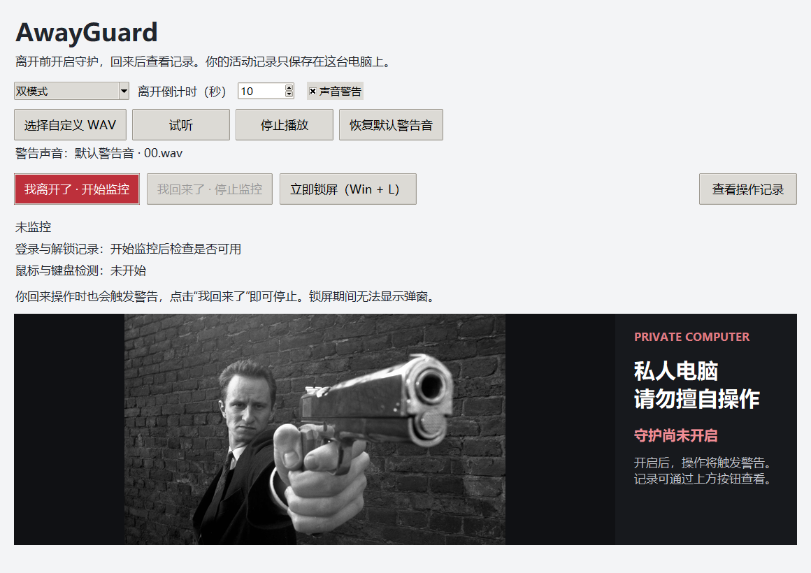
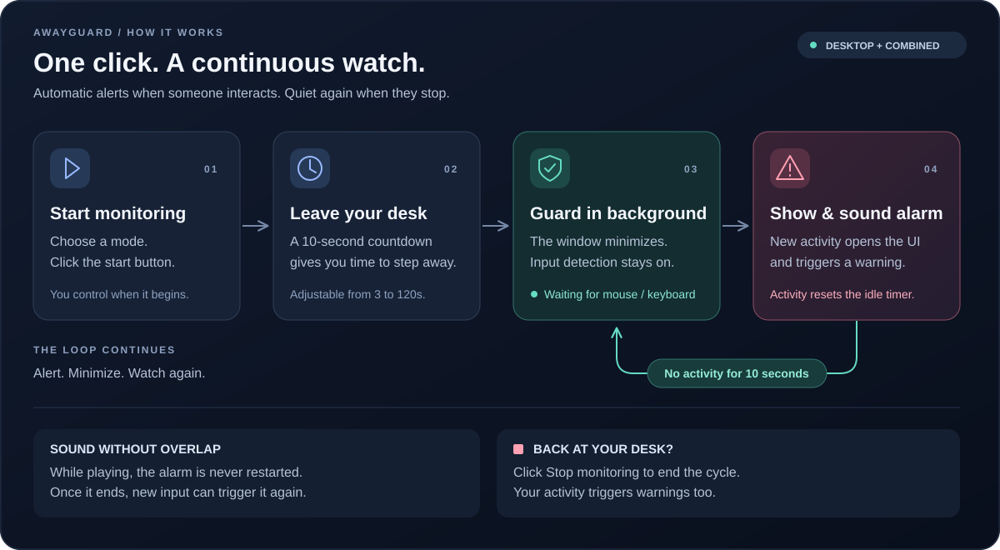

# AwayGuard

**Step away. Detect activity. Sound the alarm.**

A local Windows desktop tool that alerts you when someone uses your mouse or keyboard while you are away.

**Windows 10/11 x64 · Custom WAV alarms · Local activity logs**

## Download & run

### [Download AwayGuard for Windows →](https://github.com/Weiqiang-Jin/AwayGuard/releases)

**Recommended: install once, then launch from your desktop. No Python or terminal commands required.**

1. Open **Releases** and download `AwayGuard-Setup-x64.exe` from **Assets**.
2. Run the installer and keep **Create a desktop shortcut** selected.
3. Open **AwayGuard** from your desktop or Start menu, choose a mode, and press the red start button.

The installer uses your account's `%LOCALAPPDATA%\Programs\AwayGuard` folder. Uninstall through **Windows Settings → Apps**; your activity logs and preferences are retained.

**Prefer no installation?** Download `AwayGuard-Windows-x64.zip`, extract it, and open `AwayGuard/AwayGuard.exe`. Keep the `_internal` folder beside the executable.

After the countdown, the window minimizes. Activity restores it; ten idle seconds minimize it again. Press the adjacent stop button when you return.

*Windows downloads appear as releases are published. Choose the installer or portable ZIP, not GitHub's “Source code” archives.*



*Current interface language: Simplified Chinese.*

## How it works



Audio finishes without interruption. New activity after playback triggers it again; silence alone never repeats the alarm.

## Features

| Mode | What it records |
| --- | --- |
| Desktop | Input activity and foreground application changes |
| Lock audit | Windows lock, unlock, and interactive sign-in events |
| Combined | Both modes |

- Built-in `00.wav` alarm, custom PCM WAV files, and sound preview.
- Separate activity viewer with CSV export.
- No keystroke contents, passwords, screenshots, or uploads.

The diagram describes desktop/combined mode. Audit-only mode alerts on a detected unlock of the current session.

## Optional: lock/sign-in auditing

Right-click `AwayGuard.exe` and select **Run as administrator**. To enable the required Windows audit policies, run this once in an **administrator PowerShell** from the extracted download folder:

```powershell
powershell -NoProfile -ExecutionPolicy Bypass -File .\enable-audit.ps1
```

The script backs up the current policy before changing it. In the source repository, use `./scripts/enable-audit.ps1` instead. A successful log connection does not guarantee that auditing is enabled. Custom alerts cannot appear on the Windows lock screen.

## For developers

### Run from source

Install Python 3.10+ with Tkinter, then run in the repository folder:

```powershell
python -m pip install .
python -m awayguard
```

After installing dependencies, you can also double-click `start.bat`.

### Build & release

- **Local:** Double-click `build.bat` (Python and internet required). It installs the signature-verified Inno Setup compiler for the current user in `.tools/`, then produces `dist/AwayGuard-Setup-x64.exe` and the portable ZIP.
- **GitHub:** Select **Actions → Windows checks → Run workflow**, then download the build artifact.
- **Release:** Publishing a GitHub Release triggers tests and attaches the installer, portable ZIP and SHA-256 checksums after a successful build and scan. Use a numeric version tag such as `v0.1.2`.

Run tests:

```powershell
python -m unittest discover -s tests -v
```

## Privacy & limits

Logs and sound preferences stay in `%LOCALAPPDATA%\AwayGuard`. Logs are unencrypted and not tamper-proof. The app cannot identify the person using the computer, and exiting stops monitoring. Use **Win + L** to prevent access. Distributed builds are unsigned.

If antivirus blocks a download, do not disable protection. See [release verification and vendor review](docs/SECURITY-RELEASE.md). GitHub release uploads require a successful Defender scan; this does not guarantee acceptance by every security product.

## License

Code: [MIT](LICENSE). The bundled film image and user-supplied audio are **not covered by MIT**; redistribution rights have not been verified. See [asset sources](awayguard/assets/SOURCE.md) before public distribution.
